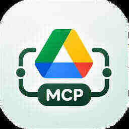

# Drivebridge

<p align="center">
  
</p>

<h3 align="center">Google Drive for your AI workspace</h3>

<p align="center">
  Connect Google Drive to MCP-compatible AI clients and manage access from one place.
</p>

<p align="center">
  <a href="https://googledrivemcp.vercel.app">Live app</a>
  ·
  <a href="https://googledrivemcpserver.vercel.app/api/docs">API documentation</a>
</p>

---

## Overview

Drivebridge is a full-stack application that exposes Google Drive capabilities through the **Model Context Protocol (MCP)**. Users sign in with Google, connect a Drive account, authorize an MCP client, and manage that client's access to individual tools.

The project contains a Next.js web application and a NestJS API/MCP server.

## Features

- **Google sign-in** — authenticate with Google and manage an application session.
- **Google Drive connection** — connect or disconnect a Google Drive account.
- **MCP OAuth** — dynamic client registration, authorization-code flow, PKCE (S256), consent, and token refresh.
- **Per-client permissions** — enable or disable individual MCP tools for each authorized client.
- **Client access management** — view authorized clients, revoke or restore access, and permanently remove an authorization grant.
- **Drive operations** — work with files, folders, permissions, comments, revisions, and shared drives.
- **Account dashboard** — review Drive connection status and manage MCP access.
- **Theme support** — light, dark, and system appearance.

## Screenshots

The repository does not currently contain captured application screenshots. The dashboard and consent screens require an authenticated session, so screenshots should be captured from a running instance using a test account before publishing this README.

Save screenshots in `docs/screenshots/` using these filenames:

| Screen | Filename |
| --- | --- |
| Home / landing page | `home.png` |
| Sign-in page | `login.png` |
| Account dashboard | `dashboard.png` |
| MCP connection setup | `mcp-connect.png` |
| MCP consent screen | `mcp-consent.png` |

Once a screenshot is added, embed it in this section with standard Markdown:

```md

```

See [docs/screenshots/README.md](./docs/screenshots/README.md) for capture guidance.

## Technology stack

| Area | Technologies |
| --- | --- |
| Frontend | Next.js 16, React 19, TypeScript |
| UI | Tailwind CSS 4, shadcn/ui, Radix UI, Lucide |
| Client state / API | Redux Toolkit, RTK Query |
| Animation | Motion |
| Backend | NestJS 12, TypeScript |
| Authentication | Passport, Google OAuth 2.0, JWT, HTTP-only cookies |
| MCP | NestJS MCP integration, OAuth authorization flow, PKCE |
| Database | PostgreSQL, Prisma ORM |
| Cache / ephemeral state | Redis |
| Validation | Zod, NestJS ValidationPipe |

## Architecture

```text
google-drive-mcp/
├── web/                         # Next.js frontend
│   ├── app/                     # App Router routes and layouts
│   ├── components/              # Shared application components
│   └── features/                # Home, auth, dashboard, MCP, account
│
└── server/                      # NestJS API and MCP server
    └── src/
        ├── config/               # Environment validation and config
        ├── modules/
        │   ├── auth/             # Google sign-in and app sessions
        │   ├── google-drive/     # Google Drive API operations
        │   ├── google-integration/ # Drive OAuth connection
        │   ├── mcp/              # MCP tools and OAuth endpoints
        │   ├── users/            # User profile
        │   └── health/           # Health checks
        ├── prisma/               # Database models and migrations
        └── redis/                # Redis integration
```

### Request flow

1. The user signs in to the web app with Google.
2. The user connects their Google Drive account.
3. An MCP client discovers the server's OAuth metadata and registers as an OAuth client.
4. The user authorizes the client and reviews the requested consent.
5. The MCP client receives tokens and calls the MCP server.
6. The server verifies the token and checks the client's active access and tool permissions before executing Drive operations.

## Getting started

### Prerequisites

- Node.js **22.12 or newer**
- pnpm
- PostgreSQL **15 or newer**
- Redis
- A Google Cloud project with the Google Drive API enabled
- Google OAuth 2.0 credentials configured for the local callback URLs

### 1. Clone the repository

```bash
git clone <your-repository-url>
cd google-drive-mcp
```

### 2. Install dependencies

Install frontend and backend dependencies separately:

```bash
cd web
pnpm install

cd ../server
pnpm install
```

### 3. Configure environment variables

Create local environment files. Do not commit real credentials or tokens.

#### Backend — `server/.env.local`

The backend validates its environment at startup. Configure these variables:

| Variable | Purpose |
| --- | --- |
| `PORT` | API port (default: `5000`) |
| `NODE_ENV` | Runtime environment: `development`, `production`, or `test` |
| `GOOGLE_CLIENT_ID` | Google OAuth client ID |
| `GOOGLE_CLIENT_SECRET` | Google OAuth client secret |
| `GOOGLE_CALLBACK_URL` | Application sign-in callback |
| `GOOGLE_DRIVE_CALLBACK_URL` | Google Drive connection callback |
| `MCP_GOOGLE_CALLBACK_URL` | MCP authorization callback |
| `GOOGLE_TOKEN_ENCRYPTION_KEY` | 64-character hexadecimal key for encrypting stored Google tokens |
| `DATABASE_URL` | PostgreSQL connection string |
| `REDIS_URL` | Redis connection string |
| `FRONTEND_URL` | Frontend origin |
| `JWT_SECRET` | Application session signing secret |
| `JWT_ACCESS_SECRET` | Access-token signing secret |
| `JWT_ACCESS_TTL` | Access-token lifetime |
| `REFRESH_TOKEN_TTL` | Refresh-token lifetime |
| `SESSION_TTL` | Session lifetime |
| `SESSION_COOKIE_NAME` | Session cookie name |
| `ACCESS_TOKEN_COOKIE_NAME` | Access-token cookie name |
| `REFRESH_TOKEN_COOKIE_NAME` | Refresh-token cookie name |
| `MCP_RESOURCE` | MCP resource URL |
| `MCP_AUTHORIZATION_SERVER` | MCP OAuth authorization-server URL |

For local development, the Google callback URLs should match the redirect URIs registered in Google Cloud Console. The local frontend proxy is configured for these callback paths:

- `http://localhost:3000/api/auth/google/callback`
- `http://localhost:3000/api/google-integration/callback`
- `http://localhost:3000/api/mcp/oauth/google/callback`

The backend supports environment-specific files: `.env.local`, `.env.prod`, and `.env.test`. Deployment-platform environment variables can also be supplied directly.

#### Frontend — `web/.env.local`

```env
NEXT_PUBLIC_AUTHOR_NAME="Your Name"
NEXT_PUBLIC_AUTHOR_PORTFOLIO_URL="https://example.com"
NEXT_PUBLIC_AUTHOR_GITHUB_URL="https://github.com/your-handle"
NEXT_PUBLIC_SITE_URL="http://localhost:3000"
NEXT_PUBLIC_BACKEND_URL="http://localhost:5000"
```

The frontend uses `NEXT_PUBLIC_BACKEND_URL` as the server-side destination for its `/api/*` rewrite proxy.

### 4. Start the services

Start PostgreSQL and Redis, then run the API and frontend in separate terminals.

**Terminal 1 — backend**

```bash
cd server
pnpm run start:dev
```

**Terminal 2 — frontend**

```bash
cd web
pnpm run dev
```

Open [http://localhost:3000](http://localhost:3000).

### 5. Database setup

The backend uses PostgreSQL and Prisma ORM. Its Prisma configuration and migration files are in `server/`.

Review [server/prisma-8.md](./server/prisma-8.md) before changing the schema or applying migrations. The documented commands include:

```bash
cd server
pnpm prisma contract emit
pnpm prisma migration status
```

Use the project's migration workflow to plan and apply database changes. Do not run production migrations against a development database (or vice versa).

## Application routes

| Route | Description |
| --- | --- |
| `/` | Landing page |
| `/login` | Google sign-in |
| `/auth/welcome` | Post-login welcome screen |
| `/dashboard` | Drive connection and MCP access dashboard |
| `/account` | Account and session settings |
| `/mcp/connect` | MCP server connection instructions |
| `/mcp/consent` | MCP authorization consent |

## API and MCP endpoints

The backend applies the global `/api` prefix.

- **Swagger UI:** `/api/docs`
- **Liveness:** `/api/health/live`
- **Database health:** `/api/health/database`
- **Redis health:** `/api/health/redis`
- **Memory health:** `/api/health/memory`
- **MCP resource:** configured through `MCP_RESOURCE`
- **OAuth authorization-server metadata:** `/.well-known/oauth-authorization-server`

The MCP tool registry includes operations for:

- **Files:** list, search, get, create, update, move, rename, copy, trash, restore, delete, download, and export.
- **Folders:** list, create, move, rename, trash, and restore.
- **Permissions:** create, get, list, update, and delete.
- **Comments:** create, get, list, update, and delete.
- **Revisions:** list and get.
- **Shared drives:** create, list, get, update, and delete.

The tool schemas and supported input fields are defined in `server/src/modules/mcp/tools/`.

## Useful development commands

### Frontend

```bash
cd web
pnpm run dev       # Start Next.js in development mode
pnpm run build     # Build the frontend
pnpm run start     # Start the production server
pnpm run lint      # Run ESLint
pnpm run typecheck # Run TypeScript checks
```

### Backend

```bash
cd server
pnpm run start:dev # Start NestJS in watch mode
pnpm run build     # Build the backend
pnpm run start:prod
pnpm run lint      # Run Oxlint
pnpm run test      # Run unit tests
pnpm run test:e2e  # Run end-to-end tests
pnpm run test:cov  # Run tests with coverage
```

## Security notes

- Never commit `.env.local`, `.env.prod`, or files containing credentials.
- Never expose Google OAuth secrets, JWT secrets, database credentials, Redis URLs, or token-encryption keys.
- Use HTTPS in production and register production callback URLs with Google.
- Grant MCP clients only the tools they need; revoke client access when it is no longer required.
- Restoring a revoked MCP grant does not make previously revoked tokens valid again; the client must authorize again to receive fresh tokens.

## License

No open-source license is currently declared for this repository. Contact the project owner before redistributing or reusing the code.
