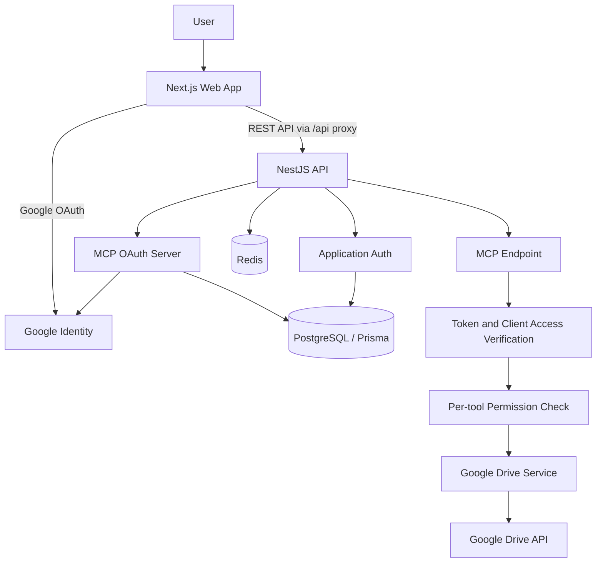

# Google Drive MCP Documentation

Google Drive MCP is a self-hosted Google Drive integration that exposes Drive operations to MCP-compatible AI clients. It includes a Next.js web dashboard and a NestJS API/MCP server.

> **Current project snapshot:** The backend MCP tool-name registry defines **36 tools**. This README documents the checked-in implementation, not Google's separate first-party Drive MCP service.

## Contents

- [Product overview](#product-overview)
- [Screenshots](#screenshots)
- [Features](#features)
- [Architecture](#architecture)
- [Technology stack](#technology-stack)
- [Quick start](#quick-start)
- [Google OAuth setup](#google-oauth-setup)
- [Environment configuration](#environment-configuration)
- [Run locally](#run-locally)
- [Connect an MCP client](#connect-an-mcp-client)
- [MCP tool reference](#mcp-tool-reference)
- [Web application routes](#web-application-routes)
- [HTTP API reference](#http-api-reference)
- [Security model](#security-model)
- [Troubleshooting](#troubleshooting)
- [Project structure](#project-structure)
- [Development](#development)
- [Deployment notes](#deployment-notes)
- [License](#license)

## Product overview

Google Drive MCP lets a user connect a Google account, authorize an MCP client, and manage exactly which MCP tools that client may call. The backend validates MCP OAuth access and checks both the client's authorization grant and its per-tool permissions before executing Drive actions.

**Repository applications**

- `web/`: Next.js web application and user dashboard.
- `server/`: NestJS API, Google OAuth integration, Google Drive service, MCP endpoint, and OAuth authorization server.
- `docs/`: product documentation and screenshot assets.

Live services:
- Web app: [googledrivemcp.vercel.app](https://googledrivemcp.vercel.app)
- API Swagger: [googledrivemcpserver.vercel.app/api/docs](https://googledrivemcpserver.vercel.app/api/docs)

## Screenshots

Screenshots must be genuine captures of the running application. The repository currently has a screenshot guide but does not yet include verified page captures. Add the images listed below to `docs/screenshots/`; the Markdown blocks will display them automatically once files exist.

### Landing page


### Google sign-in


### Account dashboard


### MCP client connection setup


### MCP authorization consent


### Authorized clients and tool permissions


Capture with a dedicated test account, remove personal data and tokens, and never commit screenshots that expose account information. See [Screenshot capture guide](./docs/screenshots/README.md).

## Features

### Account and Drive integration

- Google sign-in and application sessions.
- Connect and disconnect a Google Drive account.
- Store Google tokens encrypted at rest.
- Access files and folders through the Google Drive API.

### MCP authorization and access management

- OAuth authorization-server metadata.
- Dynamic Client Registration.
- Authorization Code flow with PKCE S256.
- Google authentication during MCP authorization.
- Consent screen before granting access.
- Access-token and refresh-token exchange.
- List, revoke, restore, and delete authorized client grants.
- Per-client tool permissions.
- Redis-backed short-lived permission cache and invalidation.

### Drive capabilities

- Search, list, inspect, create, update, copy, move, rename, trash, restore, download, and export files.
- List, create, rename, move, trash, and restore folders.
- Manage file permissions.
- Create, inspect, list, update, and delete comments.
- List and inspect file revisions.
- Create, list, inspect, update, and delete shared drives.

## Architecture



### MCP request lifecycle

1. An MCP client discovers the OAuth authorization-server metadata.
2. The client registers through Dynamic Client Registration.
3. The user is sent through Google authentication.
4. Google Drive MCP displays the pending client request and consent details.
5. The user approves or denies the request.
6. The MCP client exchanges the authorization code for tokens.
7. On a tool call, the server validates the bearer token and resolves the client grant.
8. The access service checks whether that tool is enabled for this client.
9. The Google Drive service executes the operation using the connected user's Google credentials.

## Technology stack

| Layer | Technology |
| --- | --- |
| Web | Next.js 16, React 19, TypeScript |
| UI | Tailwind CSS 4, shadcn/ui, Radix UI, Lucide |
| Client state | Redux Toolkit |
| Motion | Motion |
| API | NestJS 12, TypeScript |
| MCP | `@nestjs/mcp`, Model Context Protocol SDK |
| Google integration | Google APIs Node.js client, Passport Google OAuth |
| Database | PostgreSQL, Prisma ORM 8 release candidate |
| Cache | Redis |
| Validation | Zod, class-validator, NestJS ValidationPipe |
| Package manager | pnpm |

## Quick start

### Prerequisites

- Node.js **22.12 or later** (the backend package declares `>=22.12.0`).
- pnpm.
- PostgreSQL.
- Redis.
- Google Cloud project with Google Drive API enabled.
- Google OAuth web client credentials.

### Clone

```bash
git clone <repository-url>
cd google-drive-mcp
```

### Install dependencies

This repository has separate web and server packages:

```bash
cd web && pnpm install
cd ../server && pnpm install
```

## Google OAuth setup

1. Open [Google Cloud Console](https://console.cloud.google.com/).
2. Create or select a project.
3. Enable the **Google Drive API**.
4. Configure the Google Auth Platform consent screen and add test users when the app is in testing.
5. Create an OAuth 2.0 client with application type **Web application**.
6. Add the callback URLs that match the environment you are running.

For local development, the repository's documented callback URLs are:

| Purpose | Local callback |
| --- | --- |
| Application sign-in | `http://localhost:3000/api/auth/google/callback` |
| Drive account connection | `http://localhost:3000/api/google-integration/callback` |
| MCP Google callback | `http://localhost:3000/api/mcp/oauth/google/callback` |

The exact redirect URI registered in Google Cloud must match the configured callback URL character-for-character, including scheme, host, port, and path.

## Environment configuration

Create local environment files from the example templates. Keep all real values out of source control.

### Backend: `server/.env.local`

The backend loads and validates configuration through its configuration module. The main settings include:

| Variable | Purpose |
| --- | --- |
| `PORT` | API listening port; example uses `5000` |
| `NODE_ENV` | `development`, `production`, or `test` |
| `GOOGLE_CLIENT_ID` | Google OAuth client ID |
| `GOOGLE_CLIENT_SECRET` | Google OAuth client secret |
| `GOOGLE_CALLBACK_URL` | App sign-in callback |
| `GOOGLE_DRIVE_CALLBACK_URL` | Drive connection callback |
| `MCP_GOOGLE_CALLBACK_URL` | MCP Google callback |
| `GOOGLE_TOKEN_ENCRYPTION_KEY` | 32-byte key encoded as 64 hexadecimal characters |
| `DATABASE_URL` | PostgreSQL connection string |
| `REDIS_URL` | Redis connection string |
| `FRONTEND_URL` | Frontend origin |
| `JWT_SECRET` | Application JWT secret |
| `JWT_ACCESS_SECRET` | Access-token signing secret |
| `JWT_ACCESS_TTL` | Access-token lifetime, e.g. `15m` |
| `REFRESH_TOKEN_TTL` | Refresh-token lifetime, e.g. `30d` |
| `SESSION_TTL` | Session lifetime, e.g. `7d` |
| `SESSION_COOKIE_NAME` | Session cookie name |
| `ACCESS_TOKEN_COOKIE_NAME` | Access cookie name |
| `REFRESH_TOKEN_COOKIE_NAME` | Refresh cookie name |
| `MCP_RESOURCE` | Protected MCP resource URL |
| `MCP_AUTHORIZATION_SERVER` | MCP OAuth authorization-server URL |

Generate your own encryption key and secrets. Do not reuse any sample values from an example file. In production use HTTPS callback URLs and production secrets.

### Frontend: `web/.env.local`

```env
NEXT_PUBLIC_AUTHOR_NAME="Your Name"
NEXT_PUBLIC_AUTHOR_PORTFOLIO_URL="https://example.com"
NEXT_PUBLIC_AUTHOR_GITHUB_URL="https://github.com/your-handle"
NEXT_PUBLIC_SITE_URL="http://localhost:3000"
NEXT_PUBLIC_BACKEND_URL="http://localhost:5000"
```

The Next.js rewrite proxies `/api/*` requests to `NEXT_PUBLIC_BACKEND_URL`.

## Run locally

Start PostgreSQL and Redis before starting the backend.

**Terminal 1 — backend**

```bash
cd server
pnpm run start:dev
```

**Terminal 2 — frontend**

```bash
cd web
pnpm run dev
```

Open [http://localhost:3000](http://localhost:3000).

The backend Swagger UI is available at [http://localhost:5000/api/docs](http://localhost:5000/api/docs), assuming the default local port.

### Database workflow

The project uses Prisma ORM 8 and a repository-specific database workflow. Read these guides before generating contracts or applying schema changes:

- [Prisma 8 notes](./server/prisma-8.md)
- [Database workflow](./server/PRISMA_DATABASE_WORKFLOW.md)

The backend package exposes a `contract:emit` script:

```bash
cd server
pnpm run contract:emit
```

Check the current Prisma CLI workflow documentation in the repository before applying migrations. Do not run a development migration against production.

## Connect an MCP client

Google Drive MCP exposes a remote MCP endpoint protected by OAuth. Use the deployed endpoint or the local endpoint configured by your environment.

### Connection information

| Setting | Value |
| --- | --- |
| Server name | `Google Drive MCP` |
| Transport | Streamable HTTP (confirm client compatibility) |
| MCP resource | Value configured in `MCP_RESOURCE` |
| Authorization server | Value configured in `MCP_AUTHORIZATION_SERVER` |
| Authentication | OAuth 2.0 Authorization Code + PKCE S256 |

### Generic setup

1. Add a remote MCP server in the AI client.
2. Enter the MCP resource URL configured for your deployment.
3. Start the connection/authorization flow.
4. Complete Google sign-in.
5. Review the client identity and requested access in the consent page.
6. Approve the connection.
7. Return to the MCP client and wait for token exchange/discovery to complete.
8. Open the Google Drive MCP dashboard to manage the connected client's tool permissions.

Exact UI steps vary by MCP client. Do not paste Google client secrets into an MCP client unless that client specifically requires a separately registered OAuth client configuration.

## MCP tool reference

The server's canonical registry is `server/src/modules/mcp/tools/constants/mcp-tools.constant.ts`. It currently defines **36 tool names**.

### Files — 13 tools

| Tool | Purpose |
| --- | --- |
| `list_files` | List non-trashed Drive files |
| `search_files` | Search file names and indexed content |
| `get_file` | Read file metadata |
| `create_file` | Create a Drive file |
| `update_file` | Update file metadata and/or content |
| `move_file` | Move a file between folders |
| `rename_file` | Rename a file |
| `trash_file` | Move a file to Drive trash |
| `untrash_file` | Restore a file from Drive trash |
| `copy_file` | Copy a file |
| `delete_file` | Permanently delete a file |
| `download_file` | Download binary file content as Base64 |
| `export_file` | Export a Google Workspace-native file |

### Folders — 6 tools

| Tool | Purpose |
| --- | --- |
| `list_folders` | List folders |
| `create_folder` | Create a folder |
| `rename_folder` | Rename a folder |
| `move_folder` | Move a folder |
| `trash_folder` | Move a folder to Drive trash |
| `untrash_folder` | Restore a folder from Drive trash |

### Permissions — 5 tools

| Tool | Purpose |
| --- | --- |
| `create_permission` | Share a file or folder |
| `get_permission` | Retrieve one permission |
| `list_permissions` | List permissions |
| `update_permission` | Update a permission role/expiry |
| `delete_permission` | Remove a permission |

### Comments — 5 tools

| Tool | Purpose |
| --- | --- |
| `create_comment` | Add a comment |
| `get_comment` | Retrieve one comment |
| `list_comments` | List comments |
| `update_comment` | Update comment content or resolved state |
| `delete_comment` | Delete a comment |

### Revisions — 2 tools

| Tool | Purpose |
| --- | --- |
| `list_revisions` | List a file's revisions |
| `get_revision` | Retrieve revision metadata |

### Shared drives — 5 tools

| Tool | Purpose |
| --- | --- |
| `create_shared_drive` | Create a shared drive |
| `list_shared_drives` | List shared drives |
| `get_shared_drive` | Retrieve shared drive metadata |
| `update_shared_drive` | Rename/update a shared drive |
| `delete_shared_drive` | Delete a shared drive |

**Important:** `delete_file` and `delete_shared_drive` are destructive Google Drive actions. Prefer trash operations when you only need reversible removal. Tool availability does not bypass the Google account's Drive permissions.

## Web application routes

| Route | Purpose |
| --- | --- |
| `/` | Public landing page |
| `/login` | Google sign-in |
| `/auth/welcome` | Post-authentication welcome |
| `/dashboard` | Drive and MCP access dashboard |
| `/account` | Account settings |
| `/mcp/connect` | MCP connection instructions |
| `/mcp/consent` | Client authorization consent |

## HTTP API reference

The NestJS app applies the global `/api` prefix except for the OAuth well-known metadata routes.

| Endpoint | Description |
| --- | --- |
| `GET /api/docs` | Swagger UI |
| `GET /api/health/live` | Liveness check |
| `GET /api/health/database` | Database health |
| `GET /api/health/redis` | Redis health |
| `GET /api/health/memory` | Memory health |
| `GET /api/auth/google` | Start Google sign-in |
| `GET /api/auth/google/callback` | Handle sign-in callback |
| `GET /api/auth/me` | Current authenticated user |
| `POST /api/auth/refresh` | Rotate tokens |
| `POST /api/auth/logout` | Revoke current session |
| `POST /api/mcp/oauth/register` | Dynamic Client Registration |
| `GET /api/mcp/oauth/authorize` | Start MCP authorization |
| `GET /api/mcp/oauth/consent` | Read consent transaction |
| `POST /api/mcp/oauth/consent` | Submit consent decision |
| `POST /api/mcp/oauth/token` | Exchange authorization/refresh token |
| `GET /api/mcp/oauth/authorized-clients` | List client grants |
| `GET /api/mcp/oauth/tools` | List registered tool names |
| `GET /api/mcp/oauth/authorized-clients/:clientId/tools` | Read client tool permissions |
| `PATCH /api/mcp/oauth/authorized-clients/:clientId/tools` | Change one tool permission |
| `DELETE /api/mcp/oauth/authorized-clients/:clientId` | Revoke client access |
| `PATCH /api/mcp/oauth/authorized-clients/:clientId/restore` | Restore a revoked grant |
| `DELETE /api/mcp/oauth/authorized-clients/:clientId/access` | Delete a client grant |

The MCP OAuth controller also exposes a tool-registry refresh action. For exact request/response schemas, use Swagger and the DTOs under `server/src/modules/mcp/auth/dto/`.

## Security model

- Application access and refresh tokens are set in HTTP-only cookies.
- Google Drive tokens are protected using the configured token-encryption key.
- MCP clients must complete an OAuth authorization flow with PKCE S256.
- An active client grant is required for MCP access.
- Each tool call is checked against the individual client's tool permission.
- Permission lookups use a short-lived Redis cache; updates invalidate affected entries.
- Revoking access blocks the grant. Restoring a grant does not revive old tokens; the client must authorize again for fresh tokens.
- Never commit `.env.local`, `.env.prod`, OAuth credentials, refresh tokens, JWT secrets, database passwords, or encryption keys.
- Use HTTPS, secure cookies, restrictive origins, least-privilege Google scopes, and a protected Redis/database deployment in production.
- Treat permanent Drive deletion and shared-drive deletion as irreversible operations.

## Troubleshooting

### Google sign-in redirects but does not complete

- Confirm the Google OAuth client is a Web application.
- Compare the configured callback URL with the exact authorized redirect URI in Google Cloud.
- Confirm frontend proxy destination and backend `FRONTEND_URL`.
- Check backend logs for Passport or token validation errors.

### Drive connection fails

- Confirm Google Drive API is enabled.
- Verify the callback URL and requested Drive scopes.
- Confirm the user completed the account consent flow and tokens can be decrypted with the current encryption key.

### MCP client cannot connect

- Confirm the MCP endpoint/resource URL and authorization-server URL.
- Open the OAuth metadata endpoint and check the advertised issuer and endpoints.
- Ensure the client supports the server's Streamable HTTP transport and Authorization Code + PKCE S256.
- Reconnect and complete the consent flow; ensure the grant has not been revoked.

### A tool is missing or blocked

- Check the server registry constant and the relevant tool provider.
- Inspect the authorized client's tool settings in the dashboard.
- Refresh the client's tool registry if the server was updated after the client was authorized.
- Wait for the short-lived permission cache to expire or update permissions to trigger cache invalidation.

### Database or Redis errors

- Confirm PostgreSQL and Redis are running and reachable from the backend.
- Check `DATABASE_URL` and `REDIS_URL`.
- Review the repository Prisma workflow before applying database changes.

## Project structure

```text
google-drive-mcp/
├── docs/
│   └── screenshots/
├── server/
│   ├── src/
│   │   ├── config/
│   │   ├── modules/
│   │   │   ├── auth/
│   │   │   ├── google-drive/
│   │   │   ├── google-integration/
│   │   │   ├── health/
│   │   │   ├── mcp/
│   │   │   │   ├── auth/
│   │   │   │   └── tools/
│   │   │   └── users/
│   │   ├── prisma/
│   │   └── redis/
│   ├── prisma-8.md
│   └── PRISMA_DATABASE_WORKFLOW.md
└── web/
    ├── app/
    ├── components/
    ├── config/
    ├── features/
    ├── hooks/
    ├── lib/
    └── redux/
```

## Development

### Frontend scripts

```bash
cd web
pnpm run dev
pnpm run build
pnpm run start
pnpm run lint
pnpm run typecheck
```

### Backend scripts

```bash
cd server
pnpm run start:dev
pnpm run build
pnpm run start:prod
pnpm run lint
pnpm run test
pnpm run test:e2e
pnpm run test:cov
```

### Contribution workflow

1. Create a focused branch.
2. Keep changes scoped to one feature or fix.
3. Run relevant lint, typecheck, build, and tests.
4. Never include secrets or personal Drive screenshots.
5. Open a pull request with a summary and test evidence.

## Deployment notes

The repository has deployment configuration for Vercel in the web and server applications. Configure environment variables independently for each deployment and ensure:

- The frontend backend URL points to the deployed API.
- Backend callback URLs exactly match the deployed public origin and Google OAuth client.
- Database and Redis are provisioned and reachable.
- Secrets are unique to the production environment.
- The API and MCP endpoints are served over HTTPS.
- CORS and cookie settings are appropriate for the deployed frontend origin.

The deployed links above are provided as project references; verify the current deployment health and environment settings before relying on them.

## License

The backend package is marked `UNLICENSED` and the repository does not currently declare a top-level open-source license. Do not assume redistribution rights; add a license file after choosing the intended license.
